# Week 5 Lab: Working in Teams with GitHub

This week's lab has no notebook. Instead, two of us will work together on one repository live on screen, and then you practise the same steps in pairs. You will need this workflow for **Problem Set 3**, which you solve in pairs.

**Plan for today**

1. **Demo:** two teachers act as a team. Watch the loop below, including one merge conflict.
2. **Practice:** you do the same with your neighbour, using the exercise [`bookstore.py`](bookstore.py).

**Before you start:** VS Code with the extension **GitHub Pull Requests** installed (Extensions view, search "GitHub Pull Requests"), and signed in to GitHub.

---

## Why branches and pull requests?

When two people edit the same files, they overwrite each other's work. The solution:

- **`main`** is the shared version of the project, and it always works.
- Every piece of work (e.g. one exercise) gets its own **branch**: your own copy of the project, where you can change things without disturbing anyone.
- Changes enter `main` only through a **pull request (PR)**: "please merge my branch into `main`". Your teammate reviews it first.

| Word | Meaning |
|---|---|
| repository (repo) | the project folder, with its whole history, on GitHub |
| clone | download a copy of the repo to your laptop (once) |
| branch | a separate line of work, e.g. `ex-1-oliver` |
| commit | save a snapshot of your changes, with a short message |
| push | upload your commits to GitHub |
| pull | download the newest commits from GitHub |
| pull request (PR) | a request to merge your branch into `main`, which your teammate can review |
| merge | combine the changes of one branch into another |
| merge conflict | two branches changed the same lines; Git asks you which version to keep |

---

## The loop

```
START OF WORK        switch to main → Pull → create branch ex-<number>-<name>
WHILE WORKING        edit in branch → stage → commit (small, clear messages) → push
WHEN DONE            open PR: base = main ← compare = my branch
                     ask teammate to review → merge
AFTER ANY MERGE      everyone: switch to main → Pull
CONFLICT?            Merge origin/main → fix markers → commit → push
```

**Rules of thumb**

1. Check which branch you are on before you edit (bottom-left corner of VS Code).
2. Never work directly on `main`, and never push to `main` directly.
3. One branch per exercise, named `ex-<number>-<your name>`, e.g. `ex-1-oliver`. Always create it from an up-to-date `main`.
4. Commit small and often, and push regularly.
5. In a PR, **base** is `main` and **compare** (or "merge") is your branch.
6. After any merge: everyone switches to `main` and pulls. Merging on GitHub does not change your laptop.
7. Conflicts are normal. Talk to your teammate, then resolve them.

---

## Where to click in VS Code

| Step | How |
|---|---|
| Clone a repo | Source Control view (branch icon on the left) → **Clone Repository** → choose the repo |
| See your current branch | bottom-left corner of the window |
| Switch to `main` | click the branch name in the bottom-left corner → choose `main` |
| Pull | Source Control view → `···` → **Pull** |
| Create a branch | click on the branch name in the bottom-left corner → **+ Create new branch...** → type the name. The new branch starts from the branch you are on, so switch to `main` and pull first. |
| Commit | Source Control view → **+** next to the changed file (stage) → write a message → **Commit** |
| Push | **Publish Branch** (the first time) or **Sync Changes** in the Source Control view |
| Open a PR | GitHub view (cat icon on the left) → **Create Pull Request** icon → check BASE = `main` and MERGE = your branch → title → **Create** |
| Review a PR | GitHub view → open the PR → look at the changed files → leave a comment |
| Merge a PR | in the PR → **Merge Pull Request** |
| Bring `main` into your branch (for conflicts) | Command Palette (Cmd/Ctrl + Shift + P) → **Git: Fetch**, then **Git: Merge Branch...** → `origin/main` |
| Resolve a conflict | in the file, choose **Accept Current Change**, **Accept Incoming Change**, or **Accept Both Changes** (or edit by hand) → save → stage → commit → push |

<details>
<summary>Screenshots (the default branch there in this repository is called <code>master</code>)</summary>

Create a new branch:

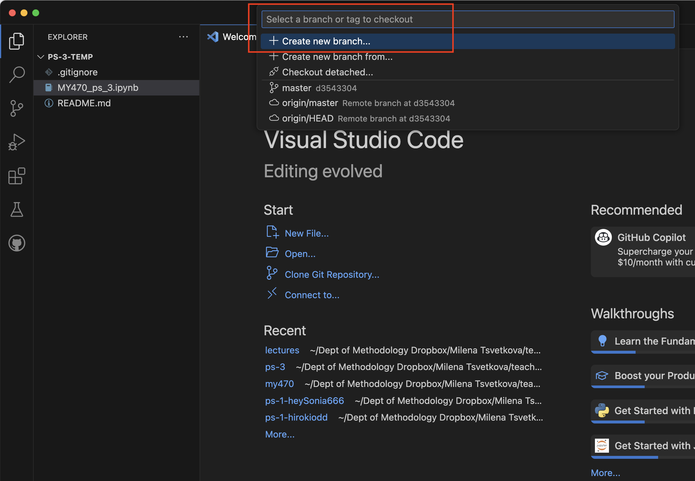

Open a pull request from the GitHub view:

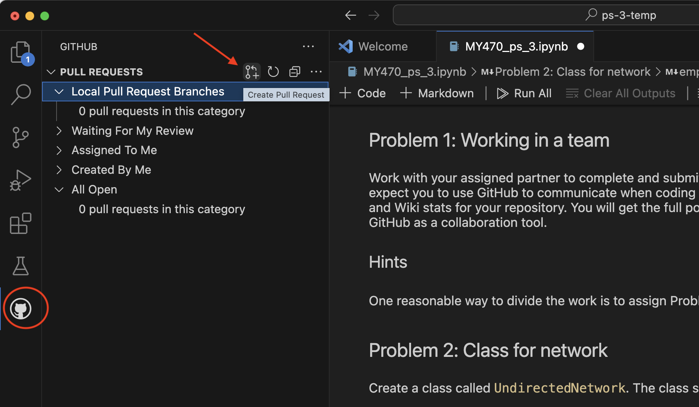

Choose base and merge branch, add a title and a description:

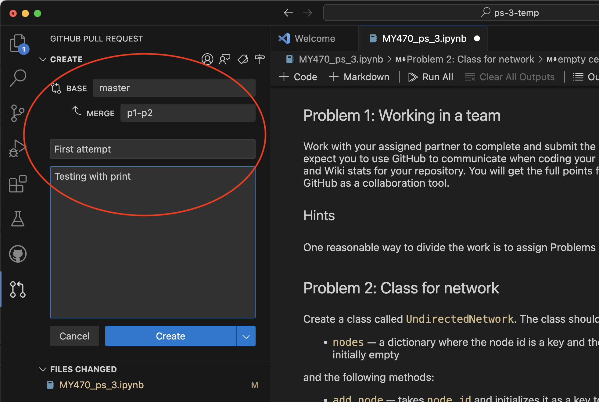

Comment and merge:

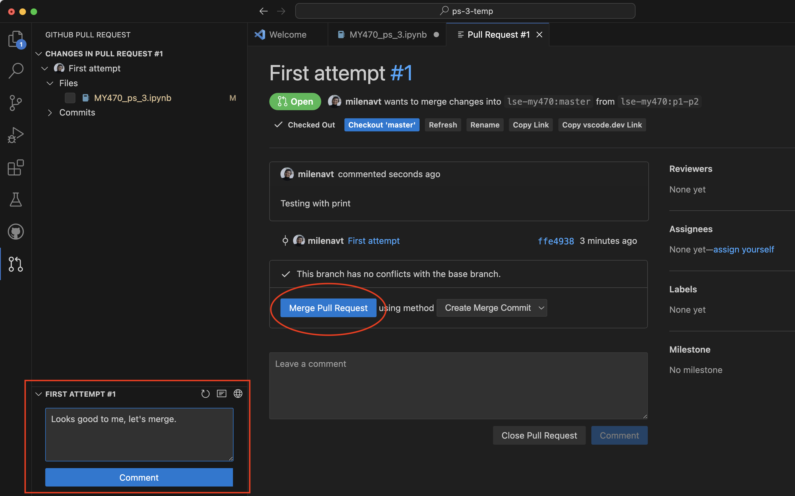

</details>

<details>
<summary>Alternative: the same workflow in the browser (on github.com)</summary>

You can also do everything on github.com, without VS Code. The screenshots are older, so GitHub looks a little different today, but the steps are the same.

1. Open the file in your repo and click the pencil icon to edit it, or upload a changed file (**Add file → Upload files**).
2. Under **Commit changes**, choose **Create a new branch for this commit and start a pull request**, give the branch a name (e.g. `ex-1-oliver`), and click **Propose changes**.

   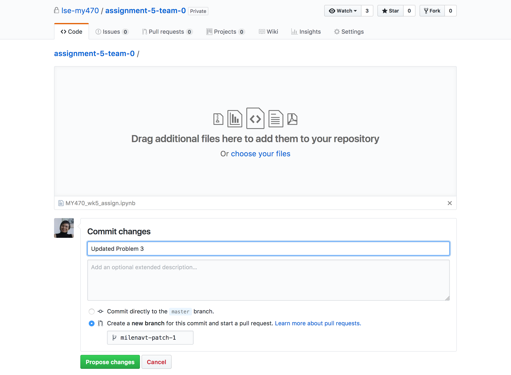

3. Check that **base** is `main` and **compare** is your branch, add a title and a description, and click **Create pull request**.

   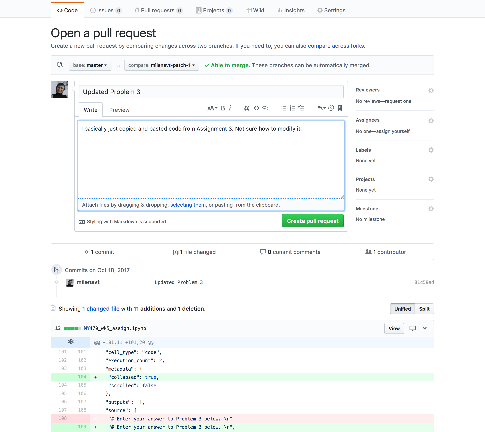

4. Your teammate opens the PR (tab **Pull requests**), looks at **Files changed** (added lines are green, removed lines red), and leaves a comment.

   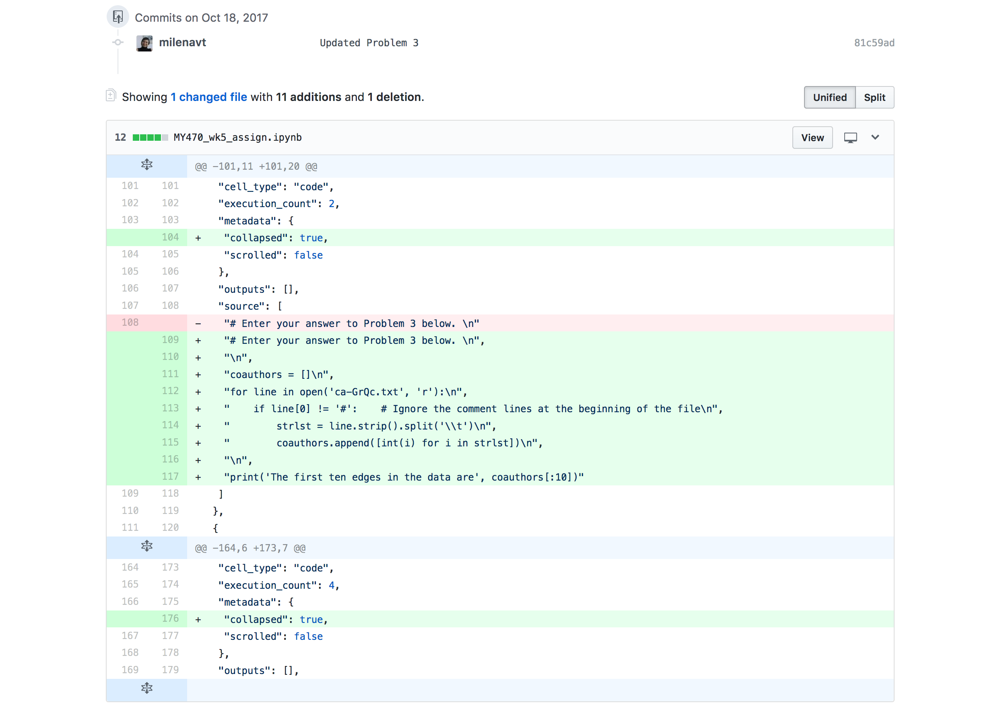

5. When you agree, click **Merge pull request**, then **Confirm merge**.

   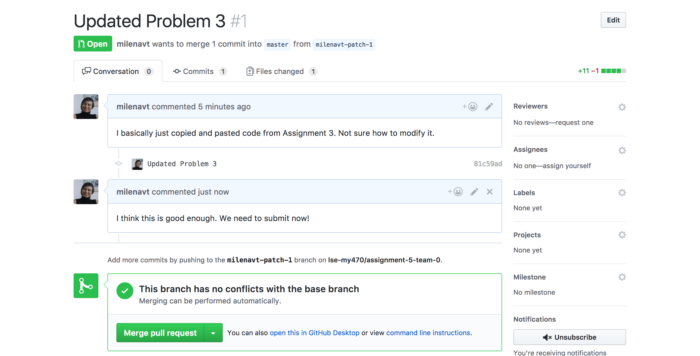

   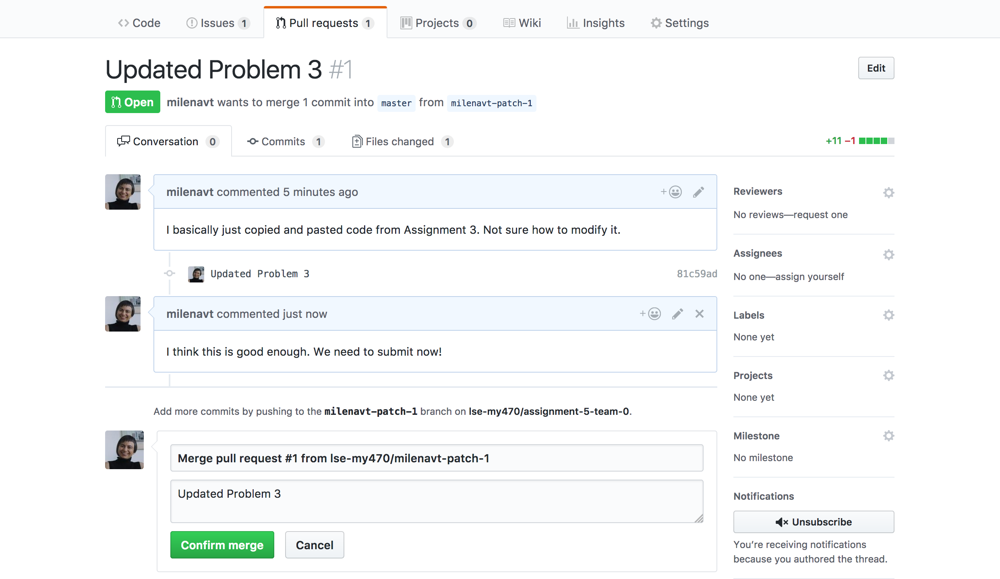

6. To discuss a problem or ask your teammate for help, use the tab **Issues → New issue**. Close the issue when it is resolved.

   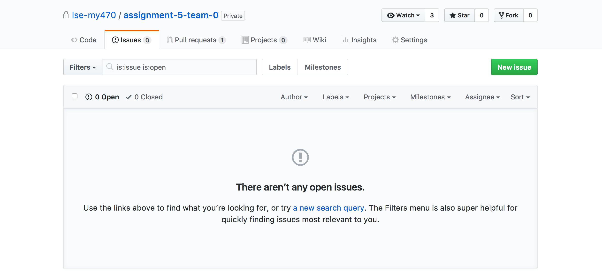

   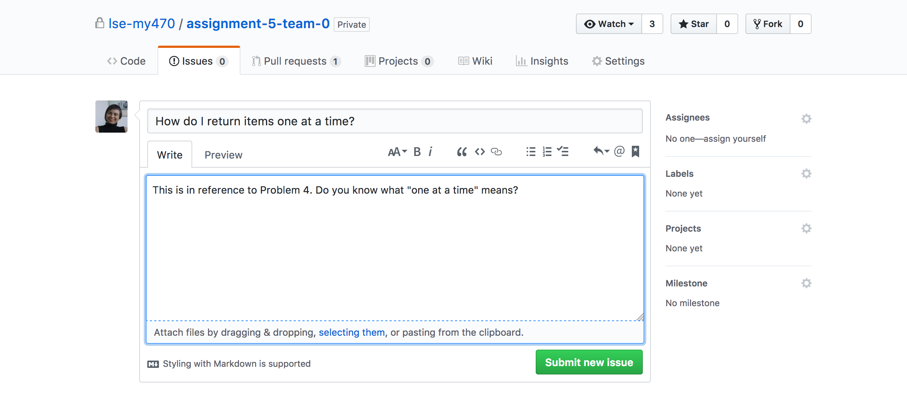

   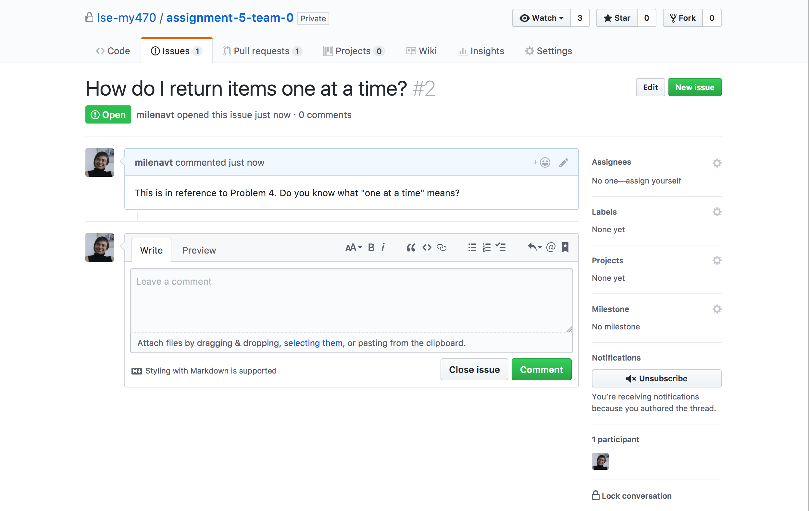

If you work in the browser and in VS Code, pull in VS Code before you continue there: changes made on github.com are not on your laptop yet.

</details>

---

## Practice: a bookstore class

Work with your neighbour. Create a **new practice repo** for this; do not use your Problem Set 3 repo. The Python is deliberately easy (one-line methods, like `get_name()` in the lecture), so you can focus on the Git steps.

The starter file [`bookstore.py`](bookstore.py) contains a class `Book` with four tasks:

| Task | Method |
|---|---|
| 1 | `get_title()` returns the title |
| 2 | `get_price()` returns the price |
| 3 (teams of three only) | `get_author()` returns the author |
| 4 | `__str__()` returns e.g. `'Persuasion by Jane Austen'` |

At the bottom of the file, each task has a test line. When your task is done, remove the `#` at the start of its line and run the file.

**Setup**

1. One person creates a new repo on GitHub (with a README), uploads `bookstore.py` (Add file → Upload files), and adds their teammate as a collaborator (Settings → Collaborators). This first upload is the only time anyone changes `main` directly.
2. The teammate accepts the invitation (e-mail or [github.com/notifications](https://github.com/notifications)).
3. Both clone the repo in VS Code.

**Round 1: working in parallel**

4. Each person takes one task: one does Task 1, the other Task 2. Create your branch from `main`, e.g. `task-1-oliver`.
5. Solve your task, run the file, then commit, push, and open a PR.
6. Review your teammate's PR and merge it. Then both switch to `main` and pull. Now `main` has both methods.

**Round 2: a merge conflict on purpose**

7. Both create a new branch from the updated `main`, e.g. `task-4-oliver`, and both solve **Task 4**, each in your own words (e.g. `'Persuasion by Jane Austen'` vs. `'Persuasion (Jane Austen)'`). Commit, push, open PRs.
8. Merge the first PR. The second PR now shows **"This branch has conflicts"**.
9. Resolve the conflict on the second branch: fetch, merge `origin/main` into it, decide together which version to keep, then save, commit, push, and merge.
10. Both switch to `main`, pull, and run `bookstore.py`.

**Finished early?** Add a method `set_price()`, swap roles (the other person merges this time), or try the same with three people.

---

## When things go wrong

| Problem | Likely cause | Fix |
|---|---|---|
| My merge does not show up on my laptop | You have not pulled | Switch to `main` → Pull |
| The PR contains changes I did not make | Your branch was created from an old `main` or from another branch, or base and compare are swapped | Check base and compare in the PR; create branches from an up-to-date `main` |
| I committed to `main` by mistake | You forgot to create or switch branch | If you have not pushed yet, ask us for help; do not push |
| The PR does not show my latest work | You committed but did not push | Push (Sync Changes) |
| I cannot push to my teammate's repo | You have not accepted the invitation | Accept it at [github.com/notifications](https://github.com/notifications) |

**For Problem Set 3:** work in the same way in your team repo. Check the name of its default branch (`main` or `master`) and use that name wherever this page says `main`.

**More help:** [Source control in VS Code](https://code.visualstudio.com/docs/sourcecontrol/overview) · [Working with GitHub in VS Code](https://code.visualstudio.com/docs/sourcecontrol/github)
